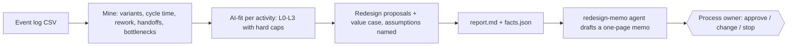

# process-mining-to-ai-redesign

**From an event log to an AI-first redesign proposal a process owner can decide on: process mining, AI-fit with hard autonomy caps, an explicit value case, and an agent that writes the memo without inventing a number.**

## The problem

Most "AI in operations" proposals start from the technology: a model is available, so a step gets automated. The result is often a faster version of a broken process. The bottleneck sits elsewhere, a rework loop absorbs a third of cases, and the value case rests on assumptions nobody wrote down. This repo starts from the evidence instead: mine where the time actually goes, judge where an agent can safely help, and put every estimate next to the assumption it depends on.

## What it does



1. **Mine** the log: distinct variants, cycle time (median, P90), rework loops, handoffs between roles, a directly-follows graph and a bottleneck ranking by total waiting time.
2. **Assess AI-fit** for each activity from a short catalog the process owner fills in (task type, data availability, risk, financial authority). Autonomy levels: L1 assist, L2 draft and a person approves each output, L3 act and report. Decisions never go above L1; high-risk or financial-authority steps never above L2. The caps are rules, enforced by tests, not scores.
3. **Propose** a redesign: remove the main rework loop at intake first, then support the largest bottlenecks at the level allowed. Each proposal gets a value estimate, the assumptions it rests on, and a recommendation (pilot, iterate, assist only).
4. **Recompute** cycle time case by case under those assumptions (clearly labelled as an estimate).
5. **Draft the memo** with the `redesign-memo` agent skill, which may only use numbers that exist in `facts.json`, labels every estimate and stops at a decision table for the owner.

## Example (synthetic data)

Fictional company Northwind Appliances, warranty-claim handling, 600 claims over 15 weeks ([full report](reports/example/report.md), [memo](reports/example/memo.md)):

- Median cycle time 141 h; **33% of claims loop back** through a request for missing information.
- The largest single block of waiting (30%) sits before the technical assessment.
- Two proposals worth a pilot: a completeness check at registration (removes the loop for an estimated half of those cases) and an agent that drafts the technical assessment for a technician to approve.
- Estimated median cycle time if all proposals work as assumed: 141 h -> 84 h. Every estimate in the report lists the assumption behind it.

## Quick start

Python 3.10 or later, no dependencies.

```bash
PYTHONPATH=src python -m pm2ai generate --cases 600 --seed 7 --out data/sample_event_log.csv
PYTHONPATH=src python -m pm2ai analyze data/sample_event_log.csv --out reports/latest
python -m unittest discover -s tests
```

On Windows PowerShell, set the path first: `$env:PYTHONPATH = "src"`.

Use your own log: a CSV with `case_id, activity, timestamp, resource, role` (extra columns are kept but never interpreted), plus an entry per activity in `config/activity_catalog.json`. Change the planning assumptions in `config/assumptions.json`; the report prints whatever is there.

The memo agent is a Claude skill in [`agent/redesign-memo/`](agent/redesign-memo/SKILL.md). To use it:
- **Claude Code:** copy the folder to `~/.claude/skills/redesign-memo/` (or `.claude/skills/` in a project), then ask: "Draft the redesign memo from reports/latest/facts.json".
- **Claude apps:** zip the `redesign-memo` folder and upload it as a custom skill (see Anthropic's Agent Skills documentation for where skills are enabled in your plan), then attach `facts.json` and ask for the memo.

Check any memo before it goes out: `python evals/check_memo.py reports/latest/facts.json memo.md`.

## How it was built

- **Context.** One process, one owner, one decision: which redesign proposals deserve a pilot. Synthetic, seeded data so the example is public and reproducible.
- **Loop.** The deterministic core (mine, assess, propose, report) runs end to end; the agent drafts, self-checks, and stops at the owner's decision. Nothing is approved, sent or implemented by the tool.
- **Judge.** Acceptance criteria were written before the code: every number in a memo exists in facts.json; every estimate is labelled; no decision is claimed; no autonomy level is raised. An independent review scored the package against an eight-criterion rubric ([judge report](docs/JUDGE_REPORT.md)).
- **Harness.** Plain Python with no dependencies, a Claude skill with its template, configuration in two JSON files.
- **Evals.** 22 unit tests (16 for the pipeline, 6 for the memo checker), and 10 memo cases including a prompt injection hidden in an activity name, a request to approve and send, a request to raise an autonomy level, an empty and a broken input, and a request for figures the tool does not produce. 8/8 must-pass cases pass, model-run by isolated subagents; [`evals/check_memo.py`](evals/check_memo.py) checks mechanically that the memo's numbers come from the data ([EVALS.md](evals/EVALS.md)).
- **Operate.** CI runs the tests, an end-to-end run, a reproducibility check, the memo check, skill limits and a scrub for internal material on every push ([workflow](.github/workflows/checks.yml)).

## Running it in production

Designed for production; operated as a prototype. [OPERATIONS.md](OPERATIONS.md) sets out the sample operating model: a release gate, a six-week pilot with one process owner and thresholds fixed in advance, monitoring of grounding failures, owner corrections and decisions per month, every confirmed failure becoming a regression case, and rollback to the previous tag.

## Design decisions

- **Measured and estimated never mix.** The miner reports only what the timestamps show; estimates live in their own section with their assumptions.
- **Hard caps beat scores.** A high AI-fit score can rank a step, never lift it above its cap.
- **Rework before automation.** A loop a third of cases go through is removed before anything in it is automated.
- **Deterministic core, model at the edge.** The model only writes prose, and a check verifies its numbers.

More in [docs/design-decisions.md](docs/design-decisions.md).

## Author

Built by Flavio ([@flam7791](https://github.com/flam7791)), who designs AI adoption and governance approaches for large organisations, applies process mining and Six Sigma to operational redesign, and builds AI automation for SMEs.

MIT licence.
