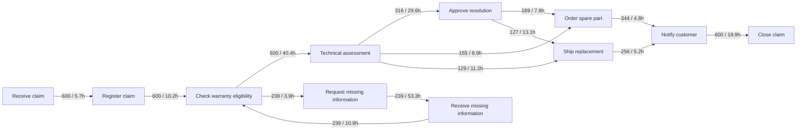

# Process mining and AI redesign: Warranty-claim handling (Northwind Appliances, synthetic)

Source: `data/sample_event_log.csv` · 600 cases · 5233 events · 2026-01-05 to 2026-04-19

> Measured figures come from the event log. Figures marked *estimate* come from the assumptions listed at the end and must be challenged by the process owner before anyone relies on them.

## 1. What the log shows (measured)

- Cycle time: median **141.0 h**, 90th percentile 244.5 h.
- Variants: 12 distinct paths; the most common covers 22% of cases.
- Rework: **33%** of cases repeat a step (Check warranty eligibility, Receive missing information, Request missing information).
- Handoffs between roles: median 5.0 per case.

### Where the time goes

| Rank | Activity | Cases | Median wait before (h) | Share of all waiting | AI level |
|---|---|---|---|---|---|
| 1 | Technical assessment | 600 | 40.4 | 30% | L2 |
| 2 | Receive missing information | 200 | 53.3 | 15% | L0 |
| 3 | Close claim | 600 | 19.9 | 15% | L3 |
| 4 | Approve resolution | 316 | 29.6 | 12% | L1 |
| 5 | Check warranty eligibility | 600 | 10.4 | 11% | L2 |
| 6 | Register claim | 600 | 5.7 | 4% | L3 |
| 7 | Ship replacement | 256 | 11.7 | 4% | L0 |
| 8 | Notify customer | 600 | 5.0 | 4% | L2 |
| 9 | Order spare part | 344 | 8.4 | 4% | L2 |
| 10 | Request missing information | 200 | 3.9 | 1% | L2 |
| 11 | Receive claim | 600 | 0.0 | 0% | L0 |

### Process map (most frequent transitions: count / median gap)

## 2. Where an agent can help (AI-fit)

| Activity | Level | Why | Guardrails |
|---|---|---|---|
| Technical assessment | L2 | task type: document_review; medium risk: a person approves each output | A named person approves every output before it leaves the team. The agent cites the record fields it used; missing fields are listed, not guessed. |
| Receive missing information | L0 | task type: external; no AI role for this kind of step | - |
| Close claim | L3 | task type: data_entry | A weekly sample of agent actions is reviewed against the acceptance criteria. Exceptions (low confidence, missing data, policy edge cases) are routed to a person. Kill switch: the step falls back to the manual procedure if error rate exceeds the agreed threshold. |
| Approve resolution | L1 | task type: judgement_decision; high risk or financial authority: never autonomous; decision stays with a person; the agent prepares the evidence only | Suggestions are shown with their source data; the person decides. |
| Check warranty eligibility | L2 | task type: rules_check; medium risk: a person approves each output | A named person approves every output before it leaves the team. The agent cites the record fields it used; missing fields are listed, not guessed. |
| Register claim | L3 | task type: data_entry | A weekly sample of agent actions is reviewed against the acceptance criteria. Exceptions (low confidence, missing data, policy edge cases) are routed to a person. Kill switch: the step falls back to the manual procedure if error rate exceeds the agreed threshold. |
| Ship replacement | L0 | task type: physical; no AI role for this kind of step | - |
| Notify customer | L2 | task type: communication | A named person approves every output before it leaves the team. The agent cites the record fields it used; missing fields are listed, not guessed. |
| Order spare part | L2 | task type: data_entry; medium risk: a person approves each output; high risk or financial authority: never autonomous | A named person approves every output before it leaves the team. The agent cites the record fields it used; missing fields are listed, not guessed. |
| Request missing information | L2 | task type: communication | A named person approves every output before it leaves the team. The agent cites the record fields it used; missing fields are listed, not guessed. |
| Receive claim | L0 | task type: system; no AI role for this kind of step | - |

Levels: L0 not applicable · L1 assist · L2 draft, person approves each output · L3 act and report, people review samples and exceptions. High-risk and financial-authority steps never go above L2; decisions never above L1.

## 3. Redesign proposals (estimates)

| ID | Change | Target | Level | Value per year (estimate) | Recommendation |
|---|---|---|---|---|---|
| P1 | An agent checks each claim for completeness at 'Register claim' and drafts the request for missing information at once, before the eligibility check, so the loop through Check warranty eligibility, Receive missing information, Request missing information is avoided. | Register claim | L3 | EUR 5,055 | pilot (cycle-time driver) |
| P2 | An agent drafts the output from the case record; a person approves each one. | Technical assessment | L2 | EUR 19,830 | pilot |
| P3 | An agent completes the step and reports; people review a weekly sample and all exceptions. | Close claim | L3 | EUR 3,807 | iterate (value below threshold) |
| P4 | An agent prepares the evidence and a suggested answer; the person decides. | Approve resolution | L1 | EUR 1,170 | assist only |
| P5 | An agent drafts the output from the case record; a person approves each one. | Check warranty eligibility | L2 | EUR 11,091 | iterate (value below threshold) |

Cycle time if all proposals work as assumed: median 141.0 h -> **84.2 h** (*estimate*: recomputed per case from the assumptions below; not a measurement).
Total value if all proposals work as assumed: **EUR 40,953 per year** (*estimate*).

## 4. Assumptions behind every estimate

| Assumption | Value |
|---|---|
| wait_reduction_by_level | {"L0": 0.0, "L1": 0.15, "L2": 0.4, "L3": 0.7} |
| effort_reduction_by_level | {"L0": 0.0, "L1": 0.2, "L2": 0.5, "L3": 0.8} |
| rework_avoided_by_intake_check | 0.5 |
| cost_per_staff_hour_eur | 45 |
| annualisation_factor | "365 / days covered by the log" |
| scale_threshold_eur_per_year | 15000 |
| max_proposals | 5 |

## 5. Approval required

Status: **awaiting process-owner review**. No proposal is implemented until a named process owner approves it.

| Proposal | Decision (approve / change / stop) | Process owner | Date |
|---|---|---|---|
| P1 | | | |
| P2 | | | |
| P3 | | | |
| P4 | | | |
| P5 | | | |
